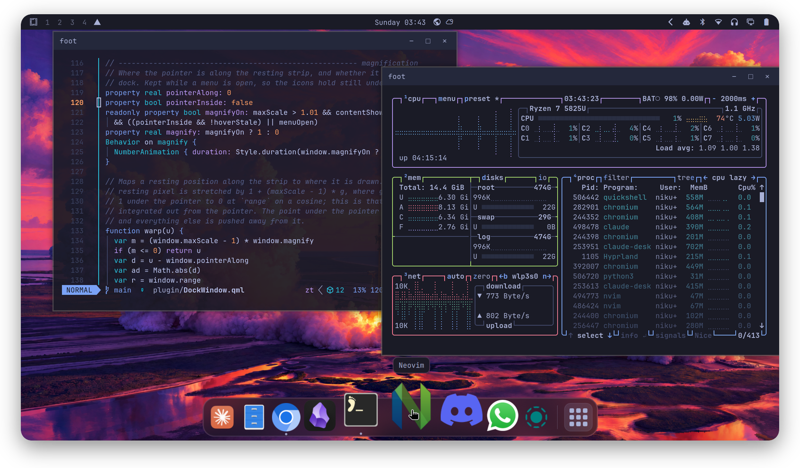
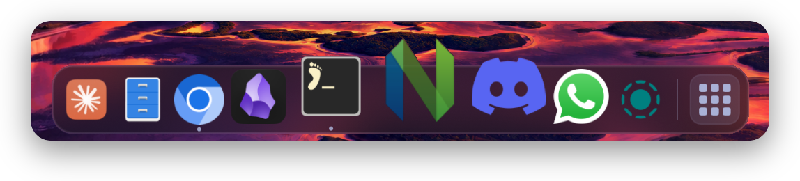
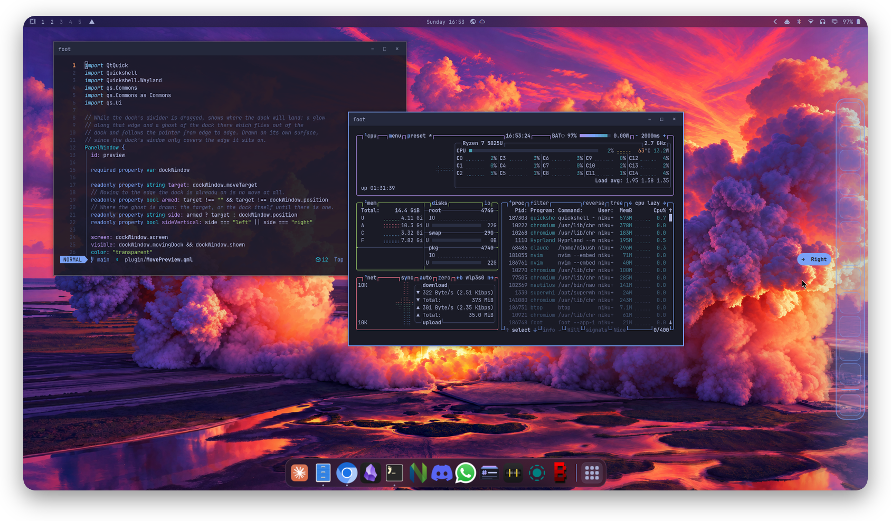

# Mac Dock for Omarchy

A macOS-style dock for [Omarchy](https://omarchy.org/): a frosted glass bar with
magnifying icons, running-app dots and launch bounce. It replaces the look of
Omarchy's built-in dock, keeps all of its behaviour, and survives
`omarchy update`.

## Screenshots



<p align="center"></p>

## Moving the dock

Drag the divider toward another screen edge and let go; a preview shows where
the dock will land.



## Install

```bash
git clone https://github.com/nlorktipa/omarchy-mac-dock
cd omarchy-mac-dock
./install.sh
```

Use `./install.sh --no-blur` to skip the Hyprland blur. The dock shows on
every workspace, and windows stay clear of it, like the top bar.

## Settings

Right-click the Applications button at the end of the dock to set its
position (Top, Bottom, Left or Right) and to toggle **Show**. With Show off,
the dock hides until the pointer reaches its edge and windows use the full
screen.

## Uninstall

```bash
./uninstall.sh
```

This brings Omarchy's built-in dock back.

## Credits

Built on Omarchy's dock (MIT). Not affiliated with Apple, and uses none of
Apple's artwork.
